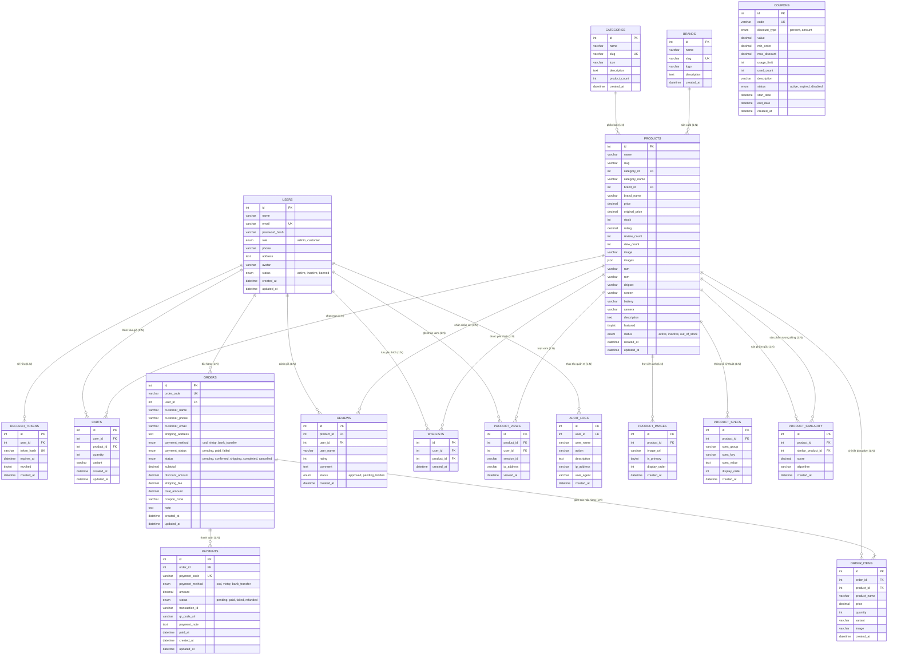

# Sơ Đồ Thực Thể Mối Quan Hệ (ERD) - TechStore Database

> **Dự án**: TechStore - Website Thương Mại Điện Tử Đồ Công Nghệ  
> **Topic 1**: RESTful API · PHP thuần, MySQL, HTML/CSS/JS  
> **Nhiệm vụ T04**: Thiết kế ERD và viết `database/schema.sql` (≥ 15 bảng)  
> **Số lượng bảng thực tế**: **17 bảng chuẩn hóa** (chia thành 4 nhóm kiến trúc)

---

## 1. Kiến trúc phân tầng CSDL (Database Architecture)

Cơ sở dữ liệu của **TechStore** được chuẩn hóa theo dạng chuẩn 3 (3NF), bao gồm **17 bảng** được phân loại vào 4 nhóm nghiệp vụ chính:

```
┌────────────────────────────────────────────────────────────────────────┐
│                        TECHSTORE DATABASE ARCHITECTURE                 │
├────────────────────┬────────────────────┬──────────────────────────────┤
│ 1. CORE ENTITIES   │ 2. COMMERCE        │ 3. INTELLIGENCE & AUDIT      │
│  - users           │  - carts           │  - product_views             │
│  - categories      │  - coupons         │  - product_similarity        │
│  - brands          │  - orders          │  - audit_logs                │
│  - products        │  - order_items     ├──────────────────────────────┤
│  - product_images  │  - payments        │ 4. AUTH & ENGAGEMENT         │
│  - product_specs   │                    │  - refresh_tokens            │
│                    │                    │  - reviews                   │
│                    │                    │  - wishlists                 │
└────────────────────┴────────────────────┴──────────────────────────────┘
```

---

## 2. Sơ đồ Mermaid ERD (Entity Relationship Diagram)



---

## 3. Từ Điển Dữ Liệu Chi Tiết (Data Dictionary)

### 3.1 Bảng `users` (Tài khoản)
| Cột | Kiểu dữ liệu | Ràng buộc | Mô tả |
|---|---|---|---|
| `id` | INT | PK, AUTO_INCREMENT | Mã định danh người dùng |
| `name` | VARCHAR(255) | NOT NULL | Họ và tên |
| `email` | VARCHAR(255) | NOT NULL, UNIQUE | Email đăng nhập |
| `password_hash` | VARCHAR(255) | NOT NULL | Chuỗi băm Bcrypt mật khẩu |
| `role` | ENUM('admin', 'customer') | NOT NULL, DEFAULT 'customer' | Phân quyền truy cập |
| `phone` | VARCHAR(20) | NULL | Số điện thoại |
| `address` | TEXT | NULL | Địa chỉ mặc định |
| `avatar` | VARCHAR(500) | NULL | Ảnh đại diện |
| `status` | ENUM('active', 'inactive', 'banned') | NOT NULL, DEFAULT 'active' | Trạng thái tài khoản |
| `created_at` | DATETIME | DEFAULT CURRENT_TIMESTAMP | Ngày tạo |
| `updated_at` | DATETIME | ON UPDATE CURRENT_TIMESTAMP | Cập nhật lần cuối |

### 3.2 Bảng `categories` (Danh mục sản phẩm)
| Cột | Kiểu dữ liệu | Ràng buộc | Mô tả |
|---|---|---|---|
| `id` | INT | PK, AUTO_INCREMENT | Mã danh mục |
| `name` | VARCHAR(100) | NOT NULL | Tên ngành hàng |
| `slug` | VARCHAR(100) | NOT NULL, UNIQUE | Đường dẫn thân thiện SEO |
| `icon` | VARCHAR(50) | NULL | Biểu tượng icon/emoji |
| `description` | TEXT | NULL | Mô tả danh mục |
| `product_count` | INT | DEFAULT 0 | Tổng số sản phẩm |
| `created_at` | DATETIME | DEFAULT CURRENT_TIMESTAMP | Ngày tạo |

### 3.3 Bảng `brands` (Thương hiệu)
| Cột | Kiểu dữ liệu | Ràng buộc | Mô tả |
|---|---|---|---|
| `id` | INT | PK, AUTO_INCREMENT | Mã thương hiệu |
| `name` | VARCHAR(100) | NOT NULL | Tên hãng sản xuất |
| `slug` | VARCHAR(100) | NOT NULL, UNIQUE | Đường dẫn thân thiện |
| `logo` | VARCHAR(255) | NULL | Ký hiệu / logo thương hiệu |
| `description` | TEXT | NULL | Giới thiệu tóm tắt |
| `created_at` | DATETIME | DEFAULT CURRENT_TIMESTAMP | Ngày tạo |

### 3.4 Bảng `products` (Sản phẩm công nghệ)
| Cột | Kiểu dữ liệu | Ràng buộc | Mô tả |
|---|---|---|---|
| `id` | INT | PK, AUTO_INCREMENT | Mã sản phẩm |
| `name` | VARCHAR(255) | NOT NULL | Tên thương mại sản phẩm |
| `slug` | VARCHAR(255) | NULL | Đường dẫn thân thiện |
| `category_id` | INT | NOT NULL, FK -> categories(id) | Mã danh mục |
| `category_name`| VARCHAR(100) | NULL | Tên danh mục đệm để query |
| `brand_id` | INT | NOT NULL, FK -> brands(id) | Mã hãng |
| `brand_name` | VARCHAR(100) | NULL | Tên hãng đệm |
| `price` | DECIMAL(15,2) | NOT NULL, DEFAULT 0 | Giá bán thực tế (VND) |
| `original_price`| DECIMAL(15,2) | NULL | Giá gốc niêm yết |
| `stock` | INT | NOT NULL, DEFAULT 0 | Số lượng tồn kho |
| `rating` | DECIMAL(3,2) | NOT NULL, DEFAULT 5.00 | Điểm đánh giá (1.00 - 5.00) |
| `review_count` | INT | NOT NULL, DEFAULT 0 | Tổng lượt đánh giá |
| `view_count` | INT | NOT NULL, DEFAULT 0 | Tổng lượt xem |
| `image` | VARCHAR(500) | NULL | Ảnh chính đại diện |
| `images` | JSON | NULL | Danh sách URL ảnh thư viện |
| `ram` | VARCHAR(50) | NULL | Dung lượng RAM |
| `rom` | VARCHAR(50) | NULL | Bộ nhớ trong / Ổ cứng |
| `chipset` | VARCHAR(100) | NULL | Vi xử lý |
| `screen` | VARCHAR(100) | NULL | Màn hình |
| `battery` | VARCHAR(100) | NULL | Pin và công nghệ sạc |
| `camera` | VARCHAR(100) | NULL | Cụm camera trước/sau |
| `description` | TEXT | NULL | Bài viết mô tả sản phẩm |
| `featured` | TINYINT(1) | NOT NULL, DEFAULT 0 | 1: Nổi bật trang chủ |
| `status` | ENUM('active','inactive','out_of_stock') | DEFAULT 'active' | Trạng thái kinh doanh |
| `created_at` | DATETIME | DEFAULT CURRENT_TIMESTAMP | Ngày thêm |
| `updated_at` | DATETIME | ON UPDATE CURRENT_TIMESTAMP | Ngày cập nhật |

### 3.5 Bảng `product_images` (Thư viện ảnh sản phẩm)
| Cột | Kiểu dữ liệu | Ràng buộc | Mô tả |
|---|---|---|---|
| `id` | INT | PK, AUTO_INCREMENT | Mã ảnh |
| `product_id` | INT | NOT NULL, FK -> products(id) ON DELETE CASCADE | Sản phẩm sở hữu ảnh |
| `image_url` | VARCHAR(500) | NOT NULL | Đường dẫn URL ảnh chất lượng cao |
| `is_primary` | TINYINT(1) | NOT NULL, DEFAULT 0 | 1 nếu là ảnh bìa chính |
| `display_order`| INT | NOT NULL, DEFAULT 0 | Thứ tự sắp xếp trong gallery |
| `created_at` | DATETIME | DEFAULT CURRENT_TIMESTAMP | Ngày thêm |

### 3.6 Bảng `product_specs` (Thông số kỹ thuật có cấu trúc)
| Cột | Kiểu dữ liệu | Ràng buộc | Mô tả |
|---|---|---|---|
| `id` | INT | PK, AUTO_INCREMENT | Mã thông số |
| `product_id` | INT | NOT NULL, FK -> products(id) ON DELETE CASCADE | Sản phẩm áp dụng |
| `spec_group` | VARCHAR(100) | DEFAULT 'Cấu hình chung' | Nhóm thông số (Màn hình, CPU...) |
| `spec_key` | VARCHAR(100) | NOT NULL | Tên thông số (RAM, Chip...) |
| `spec_value` | TEXT | NOT NULL | Giá trị thông số |
| `display_order`| INT | NOT NULL, DEFAULT 0 | Thứ tự hiển thị |
| `created_at` | DATETIME | DEFAULT CURRENT_TIMESTAMP | Ngày ghi nhận |

### 3.7 Bảng `carts` (Giỏ hàng)
| Cột | Kiểu dữ liệu | Ràng buộc | Mô tả |
|---|---|---|---|
| `id` | INT | PK, AUTO_INCREMENT | Mã mục giỏ hàng |
| `user_id` | INT | NOT NULL, FK -> users(id) ON DELETE CASCADE | Người sở hữu giỏ |
| `product_id` | INT | NOT NULL, FK -> products(id) ON DELETE CASCADE | Sản phẩm trong giỏ |
| `quantity` | INT | NOT NULL, DEFAULT 1 | Số lượng |
| `variant` | VARCHAR(100) | NULL | Phiên bản màu sắc / cấu hình |
| `created_at` | DATETIME | DEFAULT CURRENT_TIMESTAMP | Ngày tạo |
| `updated_at` | DATETIME | ON UPDATE CURRENT_TIMESTAMP | Ngày cập nhật |

### 3.8 Bảng `orders` (Đơn hàng)
| Cột | Kiểu dữ liệu | Ràng buộc | Mô tả |
|---|---|---|---|
| `id` | INT | PK, AUTO_INCREMENT | Khóa chính nội bộ |
| `order_code` | VARCHAR(50) | NOT NULL, UNIQUE | Mã đơn hiển thị (TS-xxxxxx) |
| `user_id` | INT | NULL, FK -> users(id) ON DELETE SET NULL | Người đặt (hoặc NULL nếu khách vãng lai) |
| `customer_name`| VARCHAR(255) | NOT NULL | Tên người nhận hàng |
| `customer_phone`| VARCHAR(20) | NOT NULL | Số điện thoại nhận |
| `customer_email`| VARCHAR(255) | NULL | Email nhận hóa đơn |
| `shipping_address`| TEXT | NOT NULL | Địa chỉ nhận hàng |
| `payment_method`| ENUM('cod', 'vietqr', 'bank_transfer') | DEFAULT 'cod' | Phương thức thanh toán |
| `payment_status`| ENUM('pending', 'paid', 'failed') | DEFAULT 'pending' | Trạng thái thanh toán |
| `status` | ENUM('pending', 'confirmed', 'shipping', 'completed', 'cancelled') | DEFAULT 'pending' | Tiến độ giao nhận |
| `subtotal` | DECIMAL(15,2) | NOT NULL, DEFAULT 0 | Tiền hàng gốc |
| `discount_amount`| DECIMAL(15,2) | DEFAULT 0 | Giảm giá từ coupon |
| `shipping_fee` | DECIMAL(15,2) | DEFAULT 0 | Phí ship |
| `total_amount` | DECIMAL(15,2) | NOT NULL, DEFAULT 0 | Tổng tiền cuối cùng |
| `coupon_code` | VARCHAR(50) | NULL | Mã voucher áp dụng |
| `note` | TEXT | NULL | Ghi chú đơn hàng |
| `created_at` | DATETIME | DEFAULT CURRENT_TIMESTAMP | Thời điểm đặt |
| `updated_at` | DATETIME | ON UPDATE CURRENT_TIMESTAMP | Thời điểm đổi trạng thái |

### 3.9 Bảng `order_items` (Mặt hàng chi tiết trong đơn)
| Cột | Kiểu dữ liệu | Ràng buộc | Mô tả |
|---|---|---|---|
| `id` | INT | PK, AUTO_INCREMENT | Mã mục đơn |
| `order_id` | INT | NOT NULL, FK -> orders(id) ON DELETE CASCADE | Đơn hàng cha |
| `product_id` | INT | NOT NULL, FK -> products(id) ON DELETE RESTRICT | Sản phẩm mua |
| `product_name` | VARCHAR(255) | NOT NULL | Tên sản phẩm lưu lại tại thời điểm mua |
| `price` | DECIMAL(15,2) | NOT NULL, DEFAULT 0 | Giá bán tại thời điểm mua |
| `quantity` | INT | NOT NULL, DEFAULT 1 | Số lượng mua |
| `variant` | VARCHAR(100) | NULL | Phiên bản chọn mua |
| `image` | VARCHAR(500) | NULL | Ảnh chụp sản phẩm |
| `created_at` | DATETIME | DEFAULT CURRENT_TIMESTAMP | Ngày tạo |

### 3.10 Bảng `payments` (Giao dịch thanh toán)
| Cột | Kiểu dữ liệu | Ràng buộc | Mô tả |
|---|---|---|---|
| `id` | INT | PK, AUTO_INCREMENT | Mã giao dịch nội bộ |
| `order_id` | INT | NOT NULL, FK -> orders(id) ON DELETE CASCADE | Đơn hàng thanh toán |
| `payment_code` | VARCHAR(100) | NOT NULL, UNIQUE | Mã giao dịch cổng / hệ thống |
| `payment_method`| ENUM('cod', 'vietqr', 'bank_transfer') | DEFAULT 'cod' | Kênh thanh toán |
| `amount` | DECIMAL(15,2) | NOT NULL, DEFAULT 0 | Số tiền giao dịch |
| `status` | ENUM('pending', 'paid', 'failed', 'refunded') | DEFAULT 'pending' | Trạng thái giao dịch |
| `transaction_id`| VARCHAR(100) | NULL | Mã đối soát từ Ngân hàng / Napas |
| `qr_code_url` | VARCHAR(500) | NULL | Đường dẫn ảnh QR chuẩn VietQR sinh ra |
| `payment_note` | TEXT | NULL | Cú pháp chuyển khoản |
| `paid_at` | DATETIME | NULL | Thời điểm xác nhận tiền vào tài khoản |
| `created_at` | DATETIME | DEFAULT CURRENT_TIMESTAMP | Ngày tạo giao dịch |
| `updated_at` | DATETIME | ON UPDATE CURRENT_TIMESTAMP | Ngày cập nhật |

### 3.11 Bảng `coupons` (Mã giảm giá)
| Cột | Kiểu dữ liệu | Ràng buộc | Mô tả |
|---|---|---|---|
| `id` | INT | PK, AUTO_INCREMENT | Mã voucher |
| `code` | VARCHAR(50) | NOT NULL, UNIQUE | Chuỗi mã voucher (TECH10, VIETQR50) |
| `discount_type`| ENUM('percent', 'amount') | DEFAULT 'percent' | Loại giảm (% hay tiền trực tiếp) |
| `value` | DECIMAL(15,2) | NOT NULL, DEFAULT 0 | Mức giảm |
| `min_order` | DECIMAL(15,2) | NOT NULL, DEFAULT 0 | Đơn hàng tối thiểu |
| `max_discount` | DECIMAL(15,2) | NOT NULL, DEFAULT 0 | Mức giảm trần tối đa |
| `usage_limit` | INT | NOT NULL, DEFAULT 1000 | Số lượt dùng tối đa |
| `used_count` | INT | NOT NULL, DEFAULT 0 | Số lượt đã sử dụng |
| `description` | VARCHAR(255) | NULL | Nội dung khuyến mãi |
| `status` | ENUM('active', 'expired', 'disabled') | DEFAULT 'active' | Trạng thái sử dụng |
| `start_date` | DATETIME | NULL | Ngày bắt đầu |
| `end_date` | DATETIME | NULL | Ngày kết thúc |
| `created_at` | DATETIME | DEFAULT CURRENT_TIMESTAMP | Ngày tạo mã |

### 3.12 Bảng `reviews` (Đánh giá)
| Cột | Kiểu dữ liệu | Ràng buộc | Mô tả |
|---|---|---|---|
| `id` | INT | PK, AUTO_INCREMENT | Mã đánh giá |
| `product_id` | INT | NOT NULL, FK -> products(id) ON DELETE CASCADE | Sản phẩm nhận đánh giá |
| `user_id` | INT | NULL, FK -> users(id) ON DELETE SET NULL | Người đánh giá (nếu có) |
| `user_name` | VARCHAR(255) | NOT NULL | Tên hiển thị người đánh giá |
| `rating` | INT | NOT NULL, DEFAULT 5 | Số sao (1 đến 5 sao) |
| `comment` | TEXT | NULL | Bình luận cảm nhận |
| `status` | ENUM('approved', 'pending', 'hidden') | DEFAULT 'approved' | Trạng thái kiểm duyệt |
| `created_at` | DATETIME | DEFAULT CURRENT_TIMESTAMP | Ngày gửi |

### 3.13 Bảng `wishlists` (Sản phẩm yêu thích)
| Cột | Kiểu dữ liệu | Ràng buộc | Mô tả |
|---|---|---|---|
| `id` | INT | PK, AUTO_INCREMENT | Mã yêu thích |
| `user_id` | INT | NOT NULL, FK -> users(id) ON DELETE CASCADE | Người dùng lưu |
| `product_id` | INT | NOT NULL, FK -> products(id) ON DELETE CASCADE | Sản phẩm yêu thích |
| `created_at` | DATETIME | DEFAULT CURRENT_TIMESTAMP | Ngày thêm |

### 3.14 Bảng `refresh_tokens` (JWT Refresh Token)
| Cột | Kiểu dữ liệu | Ràng buộc | Mô tả |
|---|---|---|---|
| `id` | INT | PK, AUTO_INCREMENT | Mã token |
| `user_id` | INT | NOT NULL, FK -> users(id) ON DELETE CASCADE | Người sở hữu phiên đăng nhập |
| `token_hash` | VARCHAR(255) | NOT NULL, UNIQUE | Chuỗi băm SHA256 của refresh token |
| `expires_at` | DATETIME | NOT NULL | Hạn sử dụng (thường 7 ngày) |
| `revoked` | TINYINT(1) | NOT NULL, DEFAULT 0 | 1 nếu token đã bị hủy/đăng xuất |
| `created_at` | DATETIME | DEFAULT CURRENT_TIMESTAMP | Ngày cấp |

### 3.15 Bảng `product_views` (Sự kiện xem sản phẩm)
| Cột | Kiểu dữ liệu | Ràng buộc | Mô tả |
|---|---|---|---|
| `id` | INT | PK, AUTO_INCREMENT | Mã lượt xem |
| `product_id` | INT | NOT NULL, FK -> products(id) ON DELETE CASCADE | Sản phẩm được xem |
| `user_id` | INT | NULL, FK -> users(id) ON DELETE SET NULL | Người xem (nếu đã đăng nhập) |
| `session_id` | VARCHAR(100) | NULL | Mã phiên nếu là khách vãng lai |
| `ip_address` | VARCHAR(45) | NULL | IP người truy cập |
| `viewed_at` | DATETIME | DEFAULT CURRENT_TIMESTAMP | Thời điểm xem |

### 3.16 Bảng `product_similarity` (Độ tương đồng thuật toán gợi ý)
| Cột | Kiểu dữ liệu | Ràng buộc | Mô tả |
|---|---|---|---|
| `id` | INT | PK, AUTO_INCREMENT | Mã cặp tương đồng |
| `product_id` | INT | NOT NULL, FK -> products(id) ON DELETE CASCADE | Sản phẩm nguồn |
| `similar_product_id`| INT | NOT NULL, FK -> products(id) ON DELETE CASCADE | Sản phẩm gợi ý |
| `score` | DECIMAL(5,4) | NOT NULL, DEFAULT 0.0000 | Điểm tương đồng [0.0000 - 1.0000] |
| `algorithm` | VARCHAR(50) | NOT NULL, DEFAULT 'cosine' | Thuật toán tính (cosine / apriori) |
| `created_at` | DATETIME | DEFAULT CURRENT_TIMESTAMP | Thời điểm tính toán |

### 3.17 Bảng `audit_logs` (Nhật ký kiểm toán hệ thống)
| Cột | Kiểu dữ liệu | Ràng buộc | Mô tả |
|---|---|---|---|
| `id` | INT | PK, AUTO_INCREMENT | Mã log |
| `user_id` | INT | NULL, FK -> users(id) ON DELETE SET NULL | Quản trị viên thao tác |
| `user_name` | VARCHAR(255) | NOT NULL | Tên/email người thực hiện |
| `action` | VARCHAR(100) | NOT NULL | Tên hành động (UPDATE_ORDER, CREATE_PRODUCT...) |
| `description` | TEXT | NULL | Chi tiết thay đổi dữ liệu |
| `ip_address` | VARCHAR(45) | NULL | IP thực hiện |
| `user_agent` | VARCHAR(255) | NULL | Thiết bị client |
| `created_at` | DATETIME | DEFAULT CURRENT_TIMESTAMP | Thời điểm thực hiện |
