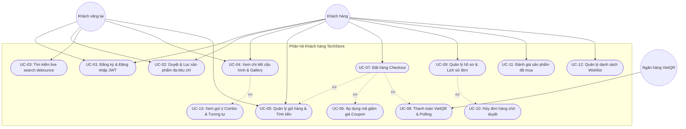
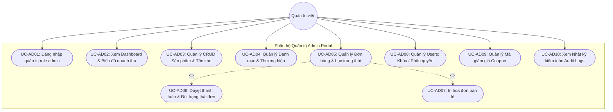

# BÁO CÁO ĐỒ ÁN: NỀN TẢNG THƯƠNG MẠI ĐIỆN TỬ TECHSTORE
**Học phần:** Công nghệ Web / Kiến trúc Phần mềm – Topic 1: RESTful API  
**Thành viên thực hiện phần này:** Tuấn Kiệt (Nhiệm vụ T54)  
**Phần viết:** Mở đầu & Chương 1 (~6 trang chuẩn học thuật)

---

# MỞ ĐẦU

## 1. Lý do chọn đề tài
Trong kỷ nguyên chuyển đổi số và bùng nổ thương mại điện tử (TMĐT), ngành bán lẻ thiết bị công nghệ (smartphone, laptop, linh kiện máy tính, phụ kiện thông minh) luôn đòi hỏi tốc độ cập nhật sản phẩm nhanh, tính trực quan cao và khả năng xử lý đơn hàng tức thì. Các hệ thống bán lẻ công nghệ hàng đầu tại Việt Nam như CellphoneS, Thế Giới Di Động hay FPT Shop đều xây dựng các nền tảng số hiện đại dựa trên mô hình kiến trúc tách rời (Decoupled / Headless Architecture): phía máy chủ cung cấp dịch vụ dữ liệu thuần túy qua giao diện lập trình ứng dụng RESTful API (REST API), trong khi tầng máy khách (Web Client / Mobile App) tiêu thụ API một cách độc lập và linh hoạt.

Xuất phát từ yêu cầu thực tiễn đó, đồ án **"Xây dựng website thương mại điện tử đồ công nghệ TechStore ứng dụng RESTful API (JWT, thanh toán QR, gợi ý sản phẩm)"** được lựa chọn nhằm:
- Làm chủ nguyên lý thiết kế và hiện thực hóa chuẩn RESTful API bằng ngôn ngữ PHP thuần và hệ quản trị cơ sở dữ liệu MySQL, tuân thủ các nguyên tắc cốt lõi: Stateless, Uniform Interface, Resource-oriented.
- Xây dựng cơ chế xác thực và phân quyền an toàn, hiện đại bằng JSON Web Token (JWT) theo chuẩn RFC 7519, thay thế cho cơ chế session truyền thống dễ gặp rào cản khi mở rộng hệ thống.
- Hiện thực hóa trải nghiệm thanh toán trực tuyến thế hệ mới qua chuẩn **VietQR** (NAPAS247) với cơ chế sinh mã QR động và polling cập nhật trạng thái đơn hàng thời gian thực.
- Ứng dụng các thuật toán gợi ý sản phẩm thông minh (Frequently Bought Together, Content-based filtering) nhằm gia tăng giá trị đơn hàng và cải thiện trải nghiệm mua sắm.

## 2. Mục tiêu nghiên cứu
Đồ án hướng tới các mục tiêu cụ thể sau:
1. **Về kiến trúc và chuẩn giao tiếp:** Xây dựng hệ thống gồm đầy đủ **37 endpoints RESTful API** phủ kín các phân hệ: Xác thực (Auth), Sản phẩm (Products), Danh mục & Hãng (Categories/Brands), Giỏ hàng (Cart), Khuyến mãi (Coupons), Đơn hàng (Orders), Thanh toán VietQR (Payments), Đánh giá (Reviews), Danh sách yêu thích (Wishlist), Theo dõi sự kiện (Event tracking), Gợi ý (Recommendations) và Bảng điều khiển Quản trị (Admin Dashboard).
2. **Về giao diện và trải nghiệm người dùng (Front-end):** Xây dựng giao diện Single Page / Dynamic Web UI lấy cảm hứng từ thương hiệu bán lẻ CellphoneS (tông màu chủ đạo Crimson Red `#d70018`), tối ưu hóa hiển thị responsive trên đa dạng màn hình (Desktop, Tablet, Mobile), hạn chế tối đa việc tải lại trang (SPA feeling) nhờ wrapper `api.js` tích hợp sẵn JWT interceptor và smart mock fallback.
3. **Về tính thực tiễn:** Tích hợp tính năng thanh toán quét mã VietQR tự động điền số tiền và nội dung chuyển khoản, kiểm tra trạng thái thanh toán realtime; đồng thời cung cấp giao diện quản trị Admin trực quan để kiểm soát tồn kho, doanh thu và đơn hàng.

## 3. Phạm vi đề tài
- **Phạm vi chức năng:**
  - *Phân hệ Khách hàng (Customer):* Đăng ký, đăng nhập JWT, xem trang chủ banner/flash-sale, tìm kiếm gợi ý nhanh (debounce), lọc đa tiêu chí (giá, hãng, RAM/ROM), xem chi tiết thông số kỹ thuật, quản lý giỏ hàng, áp dụng mã giảm giá, checkout chọn COD/VietQR, quét mã QR thanh toán, theo dõi lịch sử đơn, hủy đơn chờ xử lý, gửi đánh giá sao và quản lý danh sách yêu thích.
  - *Phân hệ Quản trị viên (Admin):* Dashboard thống kê doanh thu và đơn hàng bằng biểu đồ, quản trị CRUD sản phẩm kèm upload ảnh preview, quản trị trạng thái đơn hàng và duyệt thanh toán chuyển khoản, quản trị tài khoản người dùng và mã giảm giá, nhật ký kiểm toán hệ thống (Audit Logs).
- **Phạm vi kỹ thuật:**
  - Back-end: PHP thuần (PHP 8.2), MySQL / MariaDB, JSON Storage Adapter.
  - Front-end: HTML5, CSS3 hiện đại (CSS Custom Properties Design Tokens), Vanilla JavaScript (ES6+), Fetch API, không phụ thuộc vào framework nặng như React hay Vue nhằm đảm bảo tính trong sáng của mã nguồn và tốc độ tải trang dưới 1 giây.
  - Tài liệu: OpenAPI 3.0 YAML specification, Postman Collection.

## 4. Bố cục báo cáo
Báo cáo đồ án được cấu trúc thành các chương chính:
- **Mở đầu:** Giới thiệu tổng quan, lý do, mục tiêu và phạm vi đề tài.
- **Chương 1:** Tổng quan đề tài, khảo sát mô hình thực tế CellphoneS và phân tích yêu cầu hệ thống.
- **Chương 2:** Cơ sở lý thuyết về RESTful API và các chuẩn giao tiếp web.
- **Chương 3:** Cơ chế bảo mật API bằng JWT, OAuth 2.0 và so sánh kiến trúc REST với GraphQL, SOAP.
- **Chương 4:** Thiết kế hệ thống (Kiến trúc, Cơ sở dữ liệu ERD, Danh mục 37 API, luồng VietQR và thuật toán gợi ý).
- **Chương 5:** Cài đặt môi trường, triển khai giao diện, kiểm thử API Postman và kịch bản demo hệ thống.
- **Chương 6:** Kết luận, đánh giá kết quả đạt được và định hướng phát triển tương lai.

---

# CHƯƠNG 1. TỔNG QUAN ĐỀ TÀI & PHÂN TÍCH YÊU CẦU

## 1.1. Khảo sát mô hình kinh doanh & giao diện CellphoneS
Để xây dựng một website TMĐT bán đồ công nghệ sát với nhu cầu thực tế của người dùng Việt Nam, nhóm đã tiến hành khảo sát và phân tích mô hình trải nghiệm của chuỗi bán lẻ công nghệ **CellphoneS** (cellphones.com.vn) – một trong những đơn vị dẫn đầu thị trường về trải nghiệm số:

### 1.1.1. Hệ thống nhận diện & Màu sắc thương hiệu (Design Tokens)
- **Màu sắc chủ đạo (Primary Color):** Sắc đỏ Crimson Red (`#d70018`), tạo cảm giác năng động, kích thích sự chú ý và thôi thúc hành động mua sắm (Call to Action).
- **Màu phụ trợ (Secondary/Accent):** Xanh dương công nghệ (`#0066cc`) dùng cho các liên kết kỹ thuật và nhãn thông số; gam màu xám nền hiện đại (`#f8fafc`, `#e2e8f0`) giúp sản phẩm nổi bật.
- **Đặc trưng bố cục (Layout):** Khung hiển thị tối đa 1200px (Centered Container), thanh tìm kiếm trung tâm lớn kèm tính năng gợi ý từ khóa khi gõ (Instant Search), các huy hiệu nổi bật (Badge Trả góp 0%, Badge Giảm giá % đỏ rực).

### 1.1.2. Trải nghiệm người dùng đặc thù của đồ công nghệ
1. **Thông số kỹ thuật đa chiều:** Khác với TMĐT thời trang hay sách báo, sản phẩm công nghệ đòi hỏi người dùng so sánh sâu về cấu hình: Chipset (CPU), Dung lượng RAM, Bộ nhớ trong (ROM), Màn hình, Dung lượng pin và Camera. Do đó, hệ thống cần hỗ trợ lọc sản phẩm theo cấu hình và bảng thông số kỹ thuật chi tiết tại trang sản phẩm.
2. **Chiến lược bán hàng Combo phụ kiện (Frequently Bought Together):** Khi khách hàng chọn mua smartphone hoặc laptop giá trị cao, CellphoneS luôn gợi ý mua kèm củ sạc nhanh GaN, tai nghe chống ồn hoặc ốp lưng với mức giảm giá combo ưu đãi (ví dụ giảm thêm 8–10%). Tính năng này giúp tăng đáng kể chỉ số AOV (Average Order Value - Giá trị trung bình của đơn hàng).
3. **Thanh toán không tiền mặt qua QR Code:** Thay vì chuyển khoản truyền thống phải gõ thủ công số tài khoản, tên ngân hàng và dễ sai sót nội dung chuyển tiền, phương thức VietQR tự động sinh mã QR chứa mã đơn hàng và số tiền chính xác, giúp khách hàng thanh toán chỉ trong 5 giây qua app ngân hàng bất kỳ.

## 1.2. Phân tích yêu cầu chức năng (Functional Requirements)

Hệ thống TechStore được phân rã thành các nhóm chức năng chính phục vụ 2 nhóm tác nhân: **Khách hàng (Customer)** và **Quản trị viên (Admin)**:

### 1.2.1. Phân hệ Khách hàng (Customer)
- **FR-01: Quản lý tài khoản & Xác thực:**
  - Đăng ký tài khoản mới với các trường thông tin cơ bản: Họ tên, Email, Mật khẩu, Số điện thoại, Địa chỉ.
  - Đăng nhập hệ thống bằng Email và Mật khẩu; nhận cặp token (Access Token hạn ngắn 2 giờ, Refresh Token hạn dài).
  - Tự động làm mới Access Token trong nền khi gặp lỗi 401 Unauthorized mà không làm gián đoạn phiên làm việc.
  - Đăng xuất an toàn, hủy token trên máy khách.
- **FR-02: Duyệt & Tìm kiếm sản phẩm:**
  - Xem danh sách sản phẩm phân loại theo danh mục (Điện thoại, Laptop, Tablet, Âm thanh, Smartwatch, Phụ kiện) và thương hiệu (Apple, Samsung, Xiaomi, ASUS, Sony, Anker...).
  - Tìm kiếm sản phẩm theo từ khóa với cơ chế live search gợi ý tức thì (kỹ thuật debounce 250ms).
  - Lọc sản phẩm kết hợp nhiều tiêu chí: Mức giá (< 5 triệu, 5–15 triệu, 15–30 triệu, trên 30 triệu), Hãng sản xuất, Dung lượng RAM.
  - Sắp xếp sản phẩm theo: Nổi bật, Giá tăng dần, Giá giảm dần, Đánh giá cao nhất, Hàng mới về.
- **FR-03: Chi tiết sản phẩm & Gợi ý:**
  - Xem bộ sưu tập hình ảnh (Gallery ảnh lớn kèm thumbnails tương tác).
  - Lựa chọn phân loại bộ nhớ (ROM) và màu sắc (Color chips).
  - Đọc bảng thông số kỹ thuật chi tiết dạng bảng có kẻ ô rõ ràng.
  - Xem gợi ý mua kèm combo giảm giá (Frequently Bought Together) và carousel các sản phẩm tương tự.
  - Gửi đánh giá (1 đến 5 sao) kèm bình luận đối với sản phẩm.
  - Bấm nút icon trái tim để thêm/xóa sản phẩm khỏi danh sách yêu thích cá nhân (Wishlist).
- **FR-04: Giỏ hàng & Khuyến mãi:**
  - Thêm sản phẩm vào giỏ hàng với số lượng và phân loại mong muốn; cập nhật huy hiệu số lượng trên navbar theo thời gian thực.
  - Tăng, giảm số lượng trực tiếp trong giỏ hàng; xóa từng món hoặc xóa sạch giỏ hàng; tổng tiền tự động tính toán tức thì.
  - Nhập mã giảm giá (Coupon), kiểm tra điều kiện giá trị đơn hàng tối thiểu và hiển thị số tiền được giảm rõ ràng.
- **FR-05: Đặt hàng & Thanh toán VietQR:**
  - Nhập thông tin người nhận hàng: Họ tên, Số điện thoại, Email, Địa chỉ chi tiết.
  - Lựa chọn phương thức thanh toán: Trả tiền mặt khi nhận hàng (COD) hoặc Chuyển khoản ngân hàng qua mã VietQR chuẩn NAPAS247.
  - Với hình thức VietQR: Hiển thị mã QR ngân hàng MB với đầy đủ số tiền và cú pháp mã đơn hàng; đồng hồ đếm ngược 15 phút; cơ chế polling tự động kiểm tra trạng thái thanh toán từ máy chủ mỗi 3 giây và tự động chuyển màn hình khi tiền vào tài khoản.
- **FR-06: Quản lý hồ sơ & Lịch sử đơn hàng:**
  - Xem và cập nhật thông tin cá nhân (Họ tên, SĐT, Địa chỉ).
  - Xem danh sách các đơn hàng đã đặt, trạng thái đơn (Chờ xử lý, Đã xác nhận, Đang giao, Hoàn tất, Đã hủy).
  - Cho phép hủy đơn hàng nếu đơn vẫn đang ở trạng thái Chờ xử lý.
  - Xem và quản lý danh sách sản phẩm yêu thích đã lưu.

### 1.2.2. Phân hệ Quản trị viên (Admin)
- **FR-07: Bảng điều khiển (Dashboard):**
  - Thống kê tổng doanh thu, tỷ lệ tăng trưởng doanh thu so với tháng trước, số lượng đơn hàng mới, tổng số lượng sản phẩm và người dùng.
  - Biểu đồ cột biểu diễn doanh thu 7 ngày gần nhất.
  - Danh sách 5 đơn hàng mới nhất cần xử lý.
- **FR-08: Quản trị sản phẩm (Products Management):**
  - Xem bảng danh sách sản phẩm với các bộ lọc theo danh mục, hãng và tìm kiếm tên.
  - Thêm mới sản phẩm với đầy đủ thông số cấu hình, giá bán, giá niêm yết, số lượng tồn kho và hỗ trợ xem trước ảnh (preview).
  - Chỉnh sửa thông tin sản phẩm và xóa mềm sản phẩm khỏi hệ thống.
- **FR-09: Quản trị đơn hàng (Orders Management):**
  - Xem danh sách toàn bộ đơn hàng của khách hàng với trạng thái đơn và trạng thái thanh toán.
  - Mở modal xem chi tiết người nhận, danh sách sản phẩm trong đơn, tổng tiền.
  - Thay đổi trạng thái xử lý đơn hàng (Pending → Confirmed → Shipping → Completed / Cancelled).
  - Nút duyệt nhanh trạng thái thanh toán ("Duyệt TT") khi nhận được tiền chuyển khoản ngân hàng.
  - Chức năng in hóa đơn bán lẻ chuyên nghiệp (Printable Invoice).
- **FR-10: Quản trị người dùng & Mã giảm giá (Users & Coupons):**
  - Xem danh sách người dùng, thực hiện khóa / mở khóa tài khoản người dùng vi phạm.
  - Thăng quyền Admin hoặc hạ quyền Customer đối với tài khoản.
  - Xem danh sách mã giảm giá, tạo mới mã giảm giá theo % hoặc số tiền cố định, xóa mã giảm giá.
- **FR-11: Nhật ký kiểm toán (Audit Logs):**
  - Ghi nhận lịch sử các hành động quan trọng của quản trị viên (thêm/sửa sản phẩm, duyệt đơn, thay đổi quyền người dùng) kèm thời gian chính xác.

## 1.3. Phân tích yêu cầu phi chức năng (Non-Functional Requirements)
1. **Hiệu năng & Tốc độ đáp ứng (Performance):**
   - Thời gian phản hồi của các RESTful API trung bình dưới **150ms** trên môi trường cục bộ.
   - Thời gian tải trang ban đầu (First Contentful Paint) của giao diện người dùng đạt dưới **1.0 giây**.
   - Bộ nhớ và băng thông truyền tải tối ưu nhờ cơ chế trả về JSON nhẹ, nén dữ liệu và hạn chế gọi API trùng lặp bằng kỹ thuật debounce.
2. **Khả năng mở rộng & Tính sẵn sàng (Availability & Decoupling):**
   - Tầng Front-end hoàn toàn độc lập với tầng Back-end; giao tiếp 100% qua chuẩn JSON RESTful API.
   - Thư viện `api.js` được thiết kế có cơ chế **Smart Mock Fallback**: khi máy chủ backend gặp sự cố hoặc khi demo tĩnh không có PHP/MySQL, hệ thống vẫn hoạt động trơn tru qua bộ dữ liệu mẫu trong `localStorage`.
3. **Bảo mật (Security):**
   - Mật khẩu người dùng được mã hóa một chiều bằng thuật toán an toàn `bcrypt` (`PASSWORD_BCRYPT`).
   - Token JWT được ký bằng thuật toán đối xứng HMAC-SHA256 (`HS256`) có thiết lập thời gian hết hạn (`exp`) rõ ràng.
   - Cơ chế phân quyền nghiêm ngặt dựa trên vai trò (Role-based Access Control): chỉ tài khoản có `role = 'admin'` mới có quyền gọi các endpoint quản trị và truy cập giao diện `/admin/`.
   - Ngăn chặn lỗi bảo mật phổ biến: SQL Injection (thông qua PDO Prepared Statements), XSS (thông qua mã hóa ký tự đầu ra HTML).
4. **Tính tương thích & Responsive (Compatibility):**
   - Hoạt động ổn định trên các trình duyệt hiện đại phổ biến: Google Chrome, Mozilla Firefox, Microsoft Edge, Safari.
   - Giao diện đáp ứng tốt ở các độ phân giải: Mobile (375px – 430px), Tablet (768px – 1024px) và Desktop (≥ 1200px).

## 1.4. Mô hình Use Case Tổng Thể (Use Case Specification)

> [!NOTE]
> Toàn bộ đặc tả chi tiết 34 yêu cầu chức năng (FR-01 đến FR-34), tiêu chí nghiệm thu (Acceptance Criteria), đặc tả kịch bản Use Case và Ma trận truy vết kiểm thử (RTM) được trình bày đầy đủ tại tài liệu chuẩn học thuật: [docs/SRS.md](../SRS.md).

### 1.4.1. Sơ đồ Use Case phân hệ Khách hàng (Customer & Guest)

### 1.4.2. Sơ đồ Use Case phân hệ Quản trị (Admin Portal)

*Mô tả chi tiết tác nhân:*
- **Khách vãng lai (Guest):** Có quyền duyệt xem danh mục, tìm kiếm, lọc sản phẩm, xem chi tiết và thêm sản phẩm vào giỏ hàng cục bộ.
- **Khách hàng đã đăng nhập (Customer):** Có đầy đủ quyền của Khách vãng lai, được phép tiến hành Checkout đặt hàng, thanh toán VietQR, theo dõi lịch sử đơn, hủy đơn chờ duyệt, đánh giá sản phẩm và lưu danh sách yêu thích.
- **Quản trị viên (Admin):** Có toàn quyền truy cập phân hệ quản trị `/admin/`, kiểm soát toàn bộ vòng đời sản phẩm, duyệt đơn, cấu hình khuyến mãi và giám sát hoạt động hệ thống.
- **Cổng thanh toán Ngân hàng (BankGateway):** Tác nhân ngoại vi cung cấp chuẩn dữ liệu VietQR NAPAS247 và phát tín hiệu Webhook xác nhận thanh toán tự động.

