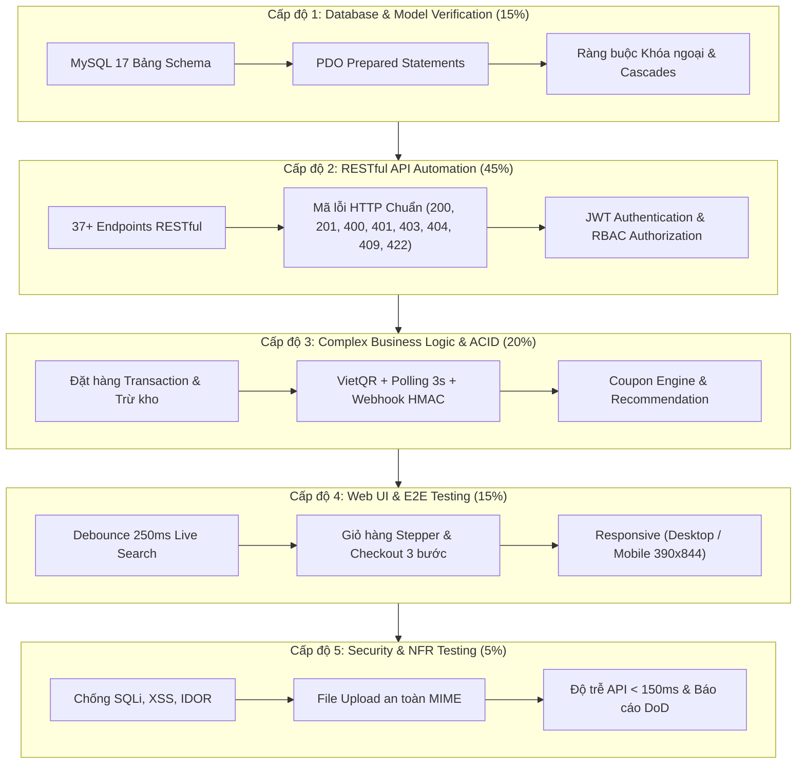
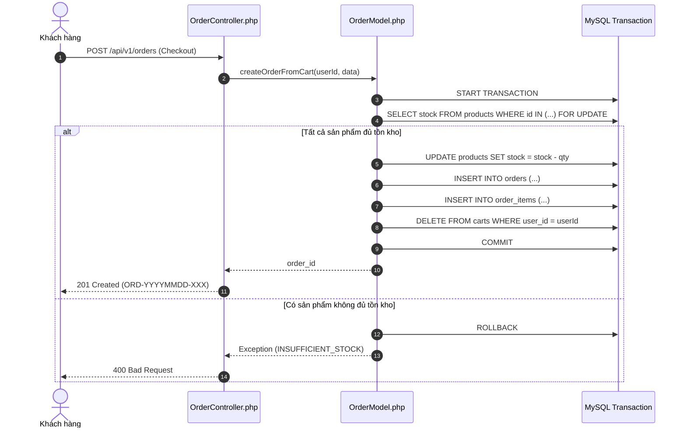
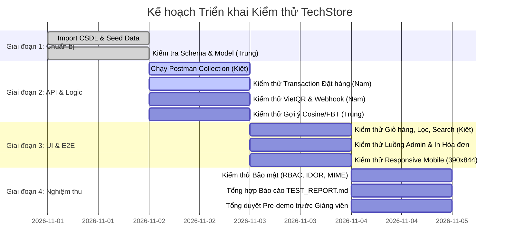

# KẾ HOẠCH KIỂM THỬ HỆ THỐNG TECHSTORE E-COMMERCE (TEST PLAN)
## DỰ ÁN: NỀN TẢNG THƯƠNG MẠI ĐIỆN TỬ THIẾT BỊ CÔNG NGHỆ TECHSTORE (RESTFUL API)

* **Chuẩn áp dụng:** IEEE 829 & ISO/IEC/IEEE 29119 (Software Testing Standards)
* **Topic môn học:** Topic 1 – RESTful API (REST Principles, JWT, VietQR, AI Recommendations)
* **Phiên bản tài liệu:** 1.0
* **Ngày lập kế hoạch:** Tháng 11/2026
* **Đối tượng bàn giao:** Hội đồng phản biện & Giảng viên hướng dẫn (ThS. Nguyễn Khắc Cường)
* **Nhóm thực hiện:** Nhóm 1 – TechStore
  - **Trần Hữu Nam:** Trưởng nhóm / Kiến trúc & Core Backend
  - **Nguyễn Thành Trung:** Backend, Database & Thuật toán
  - **Phạm Tuấn Kiệt:** Frontend, UI/UX, Postman & Tài liệu

---

## 1. TỔNG QUAN VÀ MỤC TIÊU KIỂM THỬ

### 1.1. Bối cảnh dự án
Hệ thống **TechStore** áp dụng kiến trúc tách rời (**Decoupled Clean MVC / Headless Architecture**):
- **Tầng Trình diễn (Frontend):** Vanilla HTML5, CSS3 Tokens, Vanilla JavaScript ES6+ (giao tiếp 100% qua Fetch API).
- **Tầng Dịch vụ (Backend):** PHP 8.2 thuần (không dùng framework), kiến trúc Clean MVC tự xây dựng với Front Controller (`public/index.php`) và Router riêng.
- **Tầng Dữ liệu (Database):** CSDL quan hệ MySQL 8.0 gồm 17 bảng vật lý (chuẩn hóa loại bỏ hoàn toàn `data.json`).
- **Nghiệp vụ cốt lõi:** Xác thực JWT (Access 2h, Refresh 30d lưu DB), Thanh toán động VietQR NAPAS247 (Polling 3s & Webhook HMAC-SHA256), Đặt hàng ACID Transaction, Động cơ gợi ý lai (Cosine Similarity 5D & Co-occurrence FBT).

### 1.2. Mục tiêu kiểm thử (Test Objectives)
1. Thẩm định **100% tính đúng đắn** của 10 nhóm yêu cầu chức năng (**FR01 – FR10**) và 15 quy tắc nghiệp vụ (**BR01 – BR15**).
2. Kiểm tra tính tuân thủ các nguyên lý **RESTful API** (Statelessness, HTTP Methods, HTTP Status Codes chuẩn, định dạng JSON phản hồi thống nhất).
3. Đảm bảo tính toàn vẹn dữ liệu và tính nguyên tử (**ACID Transaction**) trong các luồng nghiệp vụ nhạy cảm (đặt hàng, trừ kho, hủy đơn hoàn kho).
4. Xác minh 7 chỉ tiêu phi chức năng (**NFR01 – NFR07**) theo chuẩn **ISO/IEC 25010:2023**, đặc biệt là thời gian phản hồi API trung bình $\le 150\text{ms}$.
5. Đạt tỷ lệ vượt qua (**Pass Rate**) $100\%$ trên bộ kiểm thử tự động Postman và các kịch bản kiểm thử tích hợp trước khi nghiệm thu.

---

## 2. MÔ HÌNH KIM TỰ THÁP KIỂM THỬ (TEST PYRAMID)



---

## 3. PHẠM VI KIỂM THỬ CHI TIẾT (SCOPE & TRACEABILITY MATRIX)

Ma trận ánh xạ giữa Yêu cầu người dùng (UR), Yêu cầu chức năng (FR), Quy tắc nghiệp vụ (BR) và Trọng tâm kiểm thử:

| Phân hệ chức năng | Mã FR | Quy tắc nghiệp vụ | Use Case | Trọng tâm kiểm thử & Tiêu chuẩn nghiệm thu |
| :--- | :---: | :---: | :---: | :--- |
| **Xác thực & Phiên truy cập** | **FR01** | BR01, BR02, BR03 | UC01 | • Đăng ký tài khoản mới: chuẩn hóa email, băm bcrypt, role mặc định `customer`.<br>• Chặn trùng email (`409 Conflict`), kiểm tra validation đầu vào (`422 Unprocessable`).<br>• Đăng nhập cấp cặp Token JWT (Access Token 2h, Refresh Token 30d lưu DB).<br>• Làm mới token ngầm (Silent Refresh) khi Access Token hết hạn.<br>• Đăng xuất an toàn: xóa hash trong bảng `refresh_tokens`.<br>• Phân quyền RBAC: chặn Customer truy cập `/api/v1/admin/*` (`403 Forbidden`). |
| **Danh mục, Hãng & Chi tiết SP** | **FR02** | BR01, BR13 | UC02 | • Danh sách danh mục kèm số lượng sản phẩm `product_count`.<br>• Danh sách thương hiệu công nghệ (Apple, Samsung, ASUS, Dell...) kèm logo.<br>• Chi tiết sản phẩm: nạp thông số kỹ thuật đa tầng (`product_specs`) và gallery ảnh (`product_images`).<br>• Ghi nhận lượt xem sản phẩm vào bảng `product_views` (`202 Accepted`). |
| **Instant Search & Bộ lọc Đa tiêu chí** | **FR03** | BR01 | UC02 | • Debounce 250ms trên ô tìm kiếm header: không spam request khi đang gõ phím.<br>• Tìm kiếm không phân biệt hoa thường, tìm theo chipset/cấu hình.<br>• Lọc kết hợp đa chiều: Danh mục + Hãng + Khoảng giá + RAM + ROM.<br>• Sắp xếp linh hoạt: Giá tăng/giảm, Rating đánh giá cao nhất, Mới nhất.<br>• Phân trang độc lập không trùng lặp (`page`, `limit`), chặn DoS `limit > 100`. |
| **Giỏ hàng & Kiểm soát Tồn kho** | **FR04** | BR01, BR04 | UC03 | • Quản lý giỏ hàng phía máy chủ lưu trữ trực tiếp vào bảng `carts`.<br>• Lũy kế số lượng khi thêm cùng sản phẩm/biến thể.<br>• **Chặn vượt tồn kho khả dụng (`stock`)**: từ chối ngay lập tức (`400 Bad Request`, mã `INSUFFICIENT_STOCK`).<br>• Tự động xóa sản phẩm khỏi giỏ khi cập nhật `quantity = 0`.<br>• Cách ly giỏ hàng đa người dùng an toàn tuyệt đối (Multi-tenant User Isolation). |
| **Mã giảm giá (Coupon Engine)** | **FR05** | BR07 | UC03 | • Thẩm định mã giảm giá: còn hạn sử dụng, `usage_limit > used_count`, giá trị đơn hàng $\ge$ `min_order_value`.<br>• Tính chiết khấu chính xác theo % (có trần `max_discount_value`) hoặc số tiền cố định.<br>• Từ chối mã không hợp lệ với thông báo lỗi tiếng Việt thân thiện. |
| **Đặt hàng & Giao dịch ACID** | **FR06** | BR01, BR04, BR08 | UC04, UC06 | • **Database Transaction nguyên tử**: Khóa kiểm tra tồn kho $\rightarrow$ Trừ `products.stock` $\rightarrow$ Tạo `orders` $\rightarrow$ Tạo `order_items` $\rightarrow$ Cập nhật coupon $\rightarrow$ Dọn giỏ hàng.<br>• Tự động `ROLLBACK` 100% nếu có bất kỳ sản phẩm nào không đủ tồn kho.<br>• Sinh mã đơn hàng dạng chuẩn: `ORD-YYYYMMDD-XXX`.<br>• Khách hàng hủy đơn: Chỉ cho phép khi đơn ở trạng thái `PENDING`, tự động hoàn lại tồn kho cho các sản phẩm trong đơn.<br>• Chống IDOR: Khách A không được xem hoặc hủy đơn hàng của Khách B. |
| **Thanh toán VietQR & Webhook** | **FR07** | BR05, BR06 | UC04, UC05 | • Sinh ảnh VietQR NAPAS247 chuẩn MB Bank chứa đúng số tiền và cú pháp `TECHSTORE <ORDER_ID>`.<br>• Đồng hồ đếm ngược 15 phút; sau 15 phút trạng thái thanh toán chuyển sang `EXPIRED`.<br>• Cơ chế Polling tự động mỗi 3 giây kiểm tra trạng thái đơn.<br>• Webhook ngân hàng: Bắt buộc thẩm định chữ ký `X-Webhook-Signature` (HMAC-SHA256); cập nhật đơn sang `CONFIRMED` và thanh toán sang `PAID`.<br>• Nút duyệt thanh toán nhanh thủ công cho Admin khi có sự cố mạng. |
| **Đánh giá & Wishlist** | **FR08** | BR09 | UC07, UC08 | • Khách hàng chỉ được đánh giá 1-5 sao và bình luận khi đơn hàng đã hoàn tất (`COMPLETED`).<br>• Mỗi khách hàng chỉ được gửi tối đa 1 đánh giá cho mỗi sản phẩm đã mua.<br>• Thêm, xem và xóa sản phẩm khỏi danh sách yêu thích Wishlist. |
| **Động cơ Gợi ý AI (Recommendation)** | **FR09** | BR10, BR11, BR12 | UC09 | • Gợi ý mua kèm Combo (FBT Co-occurrence) dựa trên tần suất xuất hiện đồng thời trong `order_items`.<br>• Gợi ý tương đồng (Content-based) tính khoảng cách Cosine trên vector đặc trưng 5 chiều (Danh mục, Hãng, Giá, RAM, ROM) lưu trong `product_similarity`.<br>• Gợi ý cá nhân hóa Hybrid Score: $0.4 \times \text{Content} + 0.4 \times \text{CoOccur} + 0.2 \times \text{Views}$.<br>• Cold-start fallback sang top sản phẩm có lượt xem và rating cao nhất. |
| **Quản trị Hệ thống & Audit Log** | **FR10** | BR03, BR13, BR14, BR15 | UC10 - UC14 | • Dashboard thống kê: Doanh thu 7 ngày, đơn mới, cảnh báo tồn kho thấp (`stock < 5`).<br>• CRUD sản phẩm kèm Upload ảnh an toàn: kiểm tra MIME thực tế qua `finfo_file` ($\le 2\text{MB}$), băm tên ngẫu nhiên.<br>• In hóa đơn bán lẻ chuyên nghiệp chuẩn CSS `@media print` A4/A5.<br>• Quản lý User & Phân quyền: Cấm Admin tự khóa chính mình hoặc khóa tài khoản Admin cuối cùng.<br>• Nhật ký kiểm toán bất biến (`audit_logs`): Ghi nhận mọi thao tác nhạy cảm của Admin, cấm sửa/xóa. |

---

## 4. CHI TIẾT CÁC CẤP ĐỘ VÀ PHƯƠNG PHÁP THỰC HIỆN

### 4.1. Cấp độ 1: Database & Model Verification
* **Mục tiêu:** Xác nhận 100% CSDL MySQL đồng bộ, không sót bảng, không mồ côi dữ liệu.
* **Quy trình thực hiện:**
  ```powershell
  # 1. Đảm bảo MySQL (XAMPP 3306 hoặc Docker 3307) đang chạy
  # 2. Reset và import sạch CSDL:
  .\import_db.bat

  # 3. Chạy script thẩm tra tự động Model & Database:
  php tests/verify_mysql_sync.php
  ```
* **Nội dung kiểm chứng:**
  - 17 bảng vật lý tồn tại đầy đủ theo [database/schema.sql](file:///d:/TechStore/database/schema.sql).
  - Khóa ngoại `order_items.order_id` liên kết `orders.id` với hành vi `ON DELETE CASCADE`.
  - Khóa ngoại `cart.user_id` liên kết `users.id`.
  - Lệnh seed data nạp $\ge 40$ sản phẩm mẫu, 8 thương hiệu, 6 danh mục, $\ge 30$ đơn hàng mẫu.

---

### 4.2. Cấp độ 2: RESTful API Automated Testing (Postman / Newman / Scripts)
* **Mục tiêu:** Thẩm định 37+ API endpoints tuân thủ nguyên tắc phi trạng thái (Stateless) và chuẩn định dạng JSON.
* **Quy trình thực hiện:**
  ```powershell
  # 1. Khởi động Web Server cục bộ tại cổng 8000:
  .\start.bat

  # 2. Chạy kịch bản kiểm thử tích hợp PHP E2E:
  php tests/test_mysql_sync_e2e.php

  # 3. Chạy kịch bản kiểm thử API các phân hệ T10 - T14:
  php tests/test_api_t10_t14.php

  # 4. Chạy kiểm thử Giỏ hàng & Tồn kho tầng sâu bằng Python:
  python tests/test_fr04_deep.py
  ```
* **Chạy bộ Postman qua Newman CLI:**
  ```powershell
  newman run tests/postman_collection.json -e tests/postman_environment.json --reporters cli,htmlextra --reporter-htmlextra-export tests/newman_report.html
  ```
* **Bảng kiểm tra định dạng phản hồi chuẩn:**
  - Thành công: `200 OK` hoặc `201 Created`
    ```json
    {
      "success": true,
      "data": { ... },
      "message": "Thao tác thành công",
      "pagination": { "page": 1, "limit": 10, "total": 45 }
    }
    ```
  - Thất bại: `400`, `401`, `403`, `404`, `409`, `422`
    ```json
    {
      "success": false,
      "error": {
        "code": "INSUFFICIENT_STOCK",
        "message": "Số lượng yêu cầu vượt quá tồn kho khả dụng",
        "details": []
      }
    }
    ```

---

### 4.3. Cấp độ 3: Complex Business Logic & ACID Transaction Testing

#### 4.3.1. Kịch bản Đặt hàng ACID Transaction (Trừ tồn kho & Rollback)


#### 4.3.2. Kịch bản Thanh toán VietQR & Xác thực Webhook HMAC
1. **Khách hàng Checkout chọn VietQR:** Hệ thống gọi `POST /api/v1/payments/qr`, trả về URL ảnh QR NAPAS247 kèm hạn 15 phút.
2. **Giao diện Polling Realtime:** Client gửi `GET /api/v1/payments/{orderId}/status` mỗi 3 giây.
3. **Giả lập Webhook Ngân hàng:**
   - **Thử nghiệm Giả mạo (Negative Test):** Gửi body webhook nhưng không kèm Header `X-Webhook-Signature` hoặc dùng chữ ký sai $\rightarrow$ Hệ thống phản hồi `401 Unauthorized`, đơn hàng giữ nguyên `PENDING`.
   - **Thử nghiệm Hợp lệ (Positive Test):** Dùng chuỗi bí mật `WEBHOOK_SECRET` băm HMAC-SHA256:
     ```php
     $signature = hash_hmac('sha256', $rawPayload, $secretKey);
     ```
     Gửi request kèm Header `X-Webhook-Signature: <signature>` $\rightarrow$ Hệ thống cập nhật `orders.status = 'CONFIRMED'`, `payments.status = 'PAID'`, tự động ghi log vào `audit_logs`.

#### 4.3.3. Kịch bản Động cơ Gợi ý thông minh (AI Recommendation)
1. Chạy script tính ma trận nền:
   ```powershell
   php scripts/build_similarity.php
   ```
2. Gọi `GET /api/v1/products/1/recommendations`:
   - Xác minh mảng `similar_products`: Các sản phẩm gợi ý phải cùng danh mục, cùng khoảng giá hoặc cấu hình RAM/ROM tương đồng (điểm $\text{Cosine} \ge 0.6$).
   - Xác minh mảng `frequently_bought_together`: Trả về phụ kiện có độ tin cậy đồng xuất hiện cao nhất trong các đơn hàng lịch sử.

---

### 4.4. Cấp độ 4: Frontend UI / UX & Cross-Browser Testing
* **Môi trường đo kiểm:**
  - Desktop: Google Chrome, Microsoft Edge (Độ phân giải 1920x1080 và 1280x720).
  - Mobile: Chế độ Responsive DevTools mô phỏng iPhone 14 / Samsung Galaxy (390x844 px).
* **Kịch bản kiểm thử giao diện trọng điểm:**

| Mã Ca | Màn hình | Thao tác người dùng | Phản hồi giao diện mong đợi |
| :---: | :--- | :--- | :--- |
| **UI-01** | Header Search | Gõ từ khóa `iPhone` vào thanh tìm kiếm. | Sau 250ms ngừng gõ, popup gợi ý xổ xuống hiển thị 3 sản phẩm khớp kèm ảnh, tên và giá tiền; không gửi request dư thừa khi đang nhập. |
| **UI-02** | `pages/products.html` | Click chọn danh mục "Điện thoại", hãng "Apple", dải giá "20M - 35M". | Lưới sản phẩm cập nhật ngay lập tức qua fetch API không tải lại trang. Bấm "Xóa tất cả bộ lọc" phục hồi danh sách gốc. |
| **UI-03** | `pages/cart.html` | Bấm nút `+` / `-` số lượng món đồ. | Số lượng cập nhật mượt mà; Tạm tính và Tổng thanh toán tính lại theo thời gian thực; badge giỏ hàng trên navbar cập nhật tức thì. |
| **UI-04** | `pages/cart.html` | Nhập mã `TECHSTORE10` và bấm Áp dụng. | Khối giảm giá chuyển màu xanh, trừ tiền chiết khấu chính xác; nếu mã sai hiển thị Toast cảnh báo tiếng Việt rõ ràng. |
| **UI-05** | `admin/orders.html` | Bấm nút "In hóa đơn". | Hộp thoại in trình duyệt mở ra với định dạng hóa đơn A4/A5 gọn gàng, ẩn hoàn toàn navbar và sidebar quản trị. |

---

### 4.5. Cấp độ 5: Security & NFR Testing (Bảo mật & Hiệu năng)

Theo tiêu chuẩn **ISO/IEC 25010**, hệ thống kiểm thử 5 lỗ hổng bảo mật và chỉ tiêu hiệu năng:

```
+-----------------------------------------------------------------------------------------+
|                                KỊCH BẢN KIỂM THỬ BẢO MẬT                                |
+---------+--------------------+------------------------------------+---------------------+
| Mã Test | Loại lỗ hổng       | Hành động tấn công thử nghiệm      | Kết quả kỳ vọng     |
+---------+--------------------+------------------------------------+---------------------+
| SEC-01  | Chống IDOR         | User 2 gọi GET /orders/1 (của U1)  | 403 Forbidden       |
| SEC-02  | Phân quyền RBAC    | Customer token gọi GET /admin/stats| 403 Forbidden       |
| SEC-03  | Upload file độc    | Đổi đuôi exploit.php thành .jpg    | 400 Bad Request     |
| SEC-04  | Giả mạo chữ ký JWT | Thay đổi payload hoặc signature    | 401 Unauthorized    |
| SEC-05  | Tự khóa Admin cuối | Admin tự khóa chính mình           | 403 Forbidden       |
| PERF-01 | Độ trễ API         | Đo 50 requests liên tiếp           | Latency < 150ms     |
+---------+--------------------+------------------------------------+---------------------+
```

---

## 5. KẾ HOẠCH TRIỂN KHAI & PHÂN CÔNG NHIỆM VỤ (4 GIAI ĐOẠN)



### Phân công chi tiết:
1. **Trần Hữu Nam (Trưởng nhóm):**
   - Phụ trách kiểm thử Luồng Đặt hàng ACID Transaction (`OrderModel.php`).
   - Phụ trách kiểm thử Cổng VietQR, Polling và Xác thực Webhook HMAC (`PaymentController.php`, `QrService.php`).
   - Phụ trách kiểm thử Bảo mật: RBAC, IDOR, Token tampering.
2. **Nguyễn Thành Trung:**
   - Phụ trách kiểm thử Tầng CSDL MySQL 17 bảng (`database/schema.sql`, `database/seed.sql`).
   - Phụ trách kiểm thử Động cơ Gợi ý thông minh Cosine 5D & Co-occurrence (`scripts/build_similarity.php`, `RecommendService.php`).
   - Phụ trách đo lường hiệu năng và độ trễ hệ thống (System Latency Telemetry).
3. **Phạm Tuấn Kiệt:**
   - Phụ trách chạy và cập nhật bộ Postman Collection (`tests/postman_collection.json`).
   - Phụ trách kiểm thử Giao diện Frontend, Debounce 250ms, Stepper giỏ hàng, Bộ lọc đa tiêu chí.
   - Phụ trách kiểm thử Responsive Mobile và cập nhật tài liệu báo cáo `TEST_REPORT.md`.

---

## 6. TIÊU CHÍ NGHIỆM THU ĐỒ ÁN (DEFINITION OF DONE - DoD)

Để hoàn tất nghiệm thu và sẵn sàng bảo vệ trước Giảng viên:

- [ ] **Môi trường khởi động 1-click:** Click đúp `start.bat` mở web mượt mà tại `http://localhost:8000`, `stop.bat` tắt sạch tiến trình PHP.
- [ ] **Khởi tạo dữ liệu 1-click:** Click đúp `import_db.bat` nạp đủ 17 bảng và hơn 40 sản phẩm mẫu có hình ảnh thật.
- [ ] **Zero Data.json:** 100% dữ liệu giỏ hàng, người dùng, đơn hàng ghi nhận trực tiếp vào MySQL.
- [ ] **Postman Collection:** Đủ 37 request, các biến môi trường `{{base_url}}`, `{{token}}` tự động gán qua test script `pm.environment.set()`.
- [ ] **Mã lỗi HTTP đúng chuẩn REST:** Không bao giờ trả về HTTP 200 kèm body `{ "error": true }`. Lỗi xác thực phải là `401`, cấm quyền `403`, không tìm thấy `404`, trùng dữ liệu `409`, sai format `422`.
- [ ] **Luồng Demo chuẩn bị cho Giảng viên:**
  1. Đăng ký tài khoản $\rightarrow$ Đăng nhập nhận JWT $\rightarrow$ Tìm kiếm sản phẩm bằng debounce 250ms.
  2. Thêm vào giỏ $\rightarrow$ Chỉnh sửa số lượng $\rightarrow$ Áp mã giảm giá $\rightarrow$ Đặt hàng (ACID).
  3. Quét mã VietQR (hoặc bấm Duyệt TT bên Admin) $\rightarrow$ Đơn hàng đổi sang Đã thanh toán ngay lập tức.
  4. Xem chi tiết sản phẩm $\rightarrow$ Kiểm tra khối "Sản phẩm tương tự" và "Thường mua cùng".
  5. Đăng nhập Admin $\rightarrow$ Xem Dashboard biểu đồ doanh thu 7 ngày $\rightarrow$ In hóa đơn bán lẻ.
- [ ] **Báo cáo đồng nhất:** Số liệu trong báo cáo Word/PDF khớp 100% với tài liệu [SRS.md](../SRS.md) và kết quả đo trong [TEST_REPORT.md](../../tests/TEST_REPORT.md).

---
*Tài liệu Kế hoạch kiểm thử được biên soạn riêng cho đồ án TechStore E-Commerce (Đại học Tôn Đức Thắng).*

